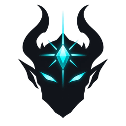
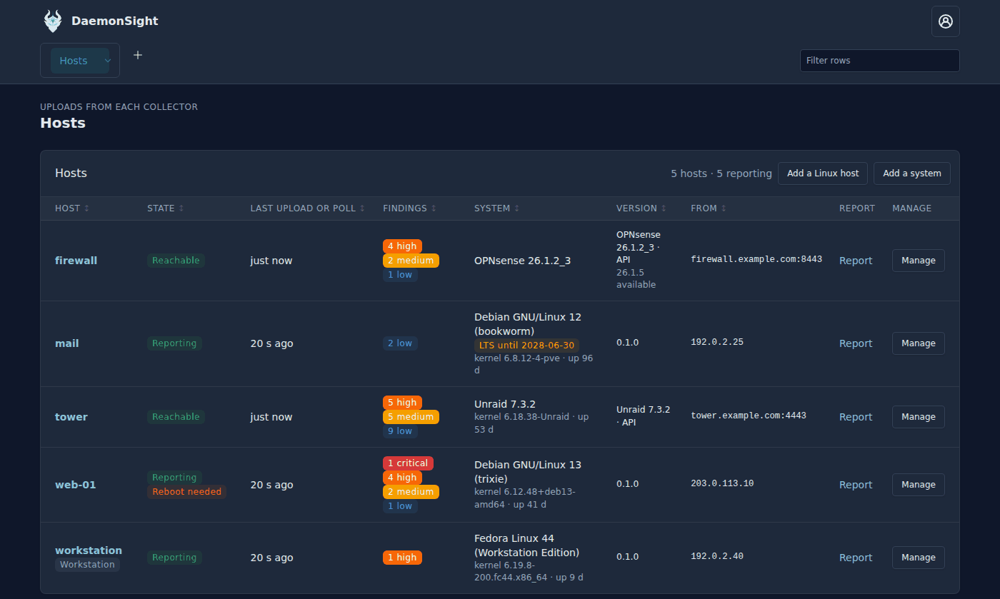
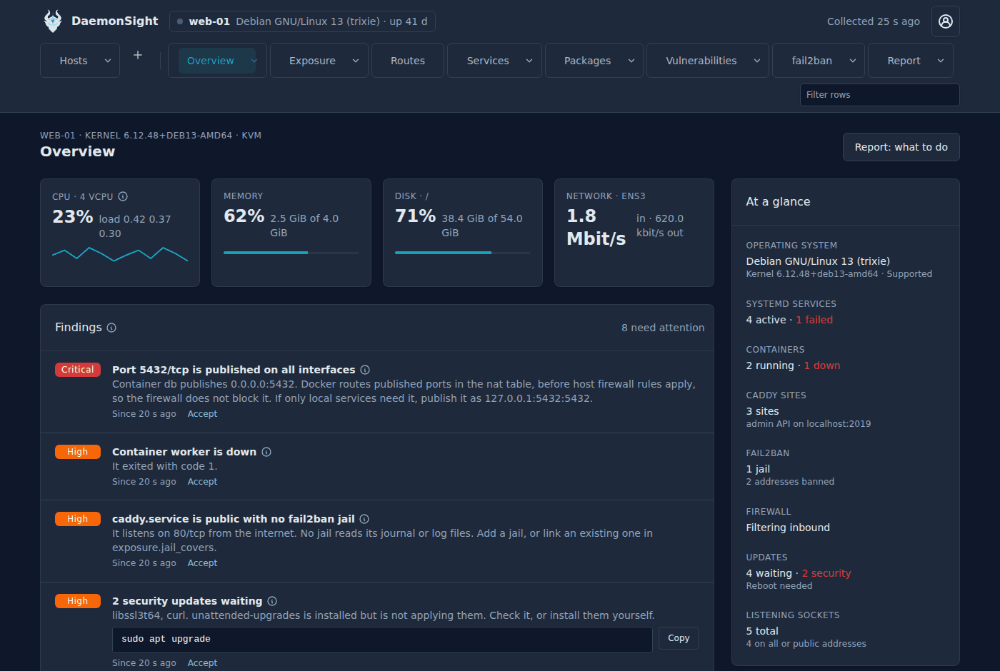
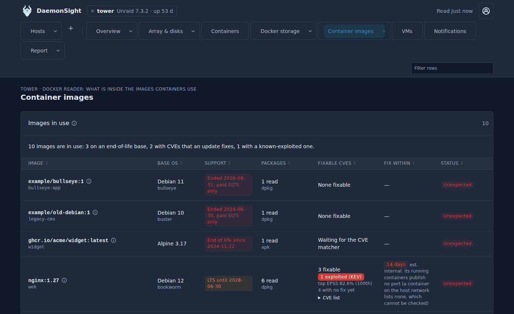
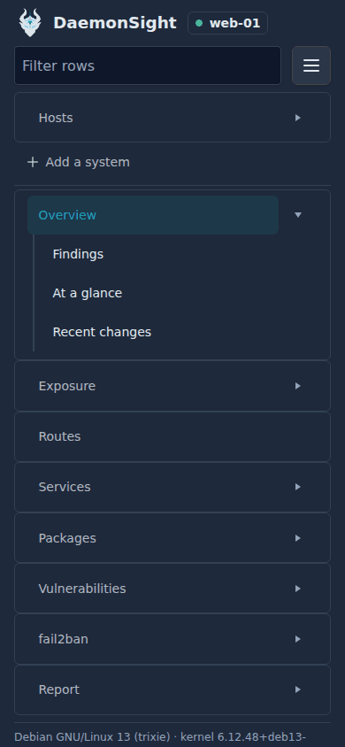

  <picture>
    <source media="(prefers-color-scheme: dark)" srcset="assets/logo-dark-256.png">
    
  </picture>

<h1 align="center">DaemonSight</h1>

<strong>Self-hosted security dashboard for Linux servers, Docker, Unraid and OPNsense</strong>

  
  

  

---

## What it is

DaemonSight is a self-hosted dashboard for home-lab and small-business admins
who run a VPS, Docker hosts, Unraid or an OPNsense firewall. It shows each
server's attack surface (what the internet can reach), the packages and
container images with known CVEs, and what changed, all from one hub. It reads
the tools already on each server, checks them against each other and says what
to do about the gaps.

**Who it is for:** one person or a small team that runs its own servers and wants
one list of what to fix, without a SIEM.

## Why DaemonSight

- One place for findings across all your hosts, each with the command that fixes it.
- What the internet can actually reach: listening ports, Caddy routes, port forwards and, if you turn it on, Shodan.
- CVEs ranked by real-world exploitation (CISA KEV, EPSS), not just counted.
- Read-only and least-privilege by design: a Viewer-only key for Unraid, GET-only calls to OPNsense.
- No agent on Unraid or OPNsense; the hub reads their APIs.
- Accepted findings stay visible with a label, and come back if what you accepted changes.

## What it monitors

| Area | What it reads |
|------|---------------|
| Host health and services | psutil, systemd over D-Bus |
| Exposure | Listening ports, nftables rules, Caddy admin API, fail2ban |
| Containers | Docker socket; on Unraid, a small read-only Docker reader |
| Host package CVEs | Debian security tracker and Canonical's Ubuntu OVAL data, CISA KEV and EPSS; Fedora advisories |
| Container image CVEs | Debian, Alpine and Ubuntu images |
| Unraid | GraphQL API, Viewer-only key |
| OPNsense and CrowdSec | REST API, GET only, and the project's changelog, with the FreeBSD and GitHub advisories it names, for the CVEs a pending update fixes; CrowdSec Local API, read-only key |
| Seen from outside | Shodan InternetDB or API (off by default) |

Details, and how it differs from general monitors and SIEMs: [docs/FEATURES.md](docs/FEATURES.md).

## Screenshots

Sample data only: made-up hosts, example.com and documentation addresses.

A collector host's Overview. Findings come first, worst at the top, with the fix a click away.

Container images on an Unraid server: each image's base OS, how long it is supported and which CVEs an update fixes.

On a phone, the header is two rows and one menu lists every page.

The pictures are remade by CI when the web UI changes ([how](docs/DESIGN.md#screenshots)).

## Install

Two parts: a hub that shows every host, and a collector on each Debian, Ubuntu
or Fedora host.

- **Hub:** a container image (`ghcr.io/bradbrownjr/daemonsight`), with an Unraid template.
- **Collector:** `sudo ./install.sh` on the host, then `sudo daemonsight set-password`. The UI listens on `127.0.0.1:8466`.

Steps, options, reverse proxies and updating: [docs/INSTALL.md](docs/INSTALL.md).

## Documentation

- [Install](docs/INSTALL.md): install, hub, settings, updating, removal
- [Features](docs/FEATURES.md): what each part does
- [Design](docs/DESIGN.md): architecture, data model and the [phases](docs/DESIGN.md#phases) (roadmap)
- [UI standards](docs/UI.md): layout, wording and how pages are checked
- [Security](SECURITY.md): how it protects the hosts it runs on

## Status

Phase 3 of 5: package updates, CVE matching and the first part of container image scanning are built. See the [phases](docs/DESIGN.md#phases) for what is next.

## Security

How DaemonSight protects the hosts it runs on, and how to report a vulnerability: [SECURITY.md](SECURITY.md).

## License

MIT. See [LICENSE](LICENSE).

Portions of this project were developed with AI assistance (Claude).
